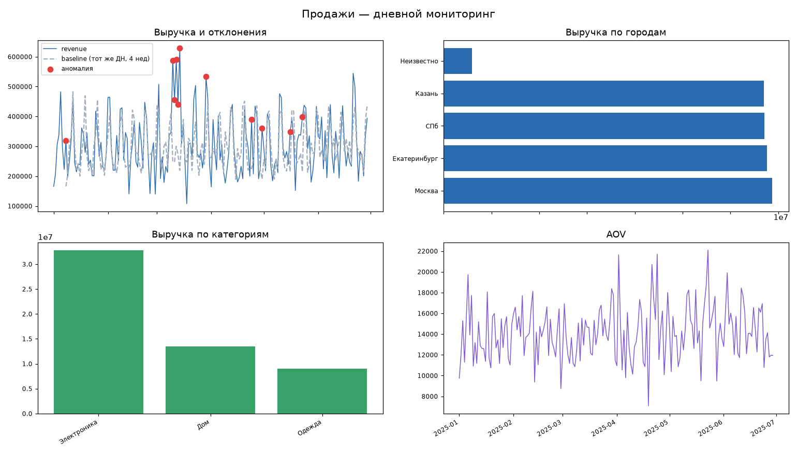

# Мониторинг продаж магазина

Стек: Python, DuckDB, SQL.

В качестве данных используются синтетические заказы за 6 месяцев (около 4,5 тысяч строк), в которых имеются дубли, пропуски в city, отменённые заказы и promo-всплеск 10–14 марта.

## Пайплайн

В файле `data/orders_raw.csv` лежат сырые данные.
В файле `sql/01_clean.sql` лежит SQL-код для чистки и фильтрации данных, подгруженных из `data/orders_raw.csv`.
В файле `sql/02_mart_daily.sql` лежит SQL-код подсчёта статистик на основе агрегаций, а также детектор аномалий. В итоге создаются 2 витрины: дневные метрики и флаги отклонений

## Метрики и детектор аномалий

| Метрика | Определение |
|---|---|
| revenue | сумма оплаченных заказов, ₽ |
| orders / units | число заказов / число позиций |
| aov | revenue / orders |
| revenue_base | медиана revenue того же дня недели за 4 предыдущие недели |
| revenue_dev_pct | (revenue − base) / base, % |

Аномалия = `|revenue_dev_pct| > 60%`.

## Запуск

```bash
pip install -r requirements.txt
python generate_data.py   # данные (уже лежат в data/, можно перегенерить)
python etl.py             # ETL: чистка, витрины, выгрузка CSV, отчёт по аномалиям
python dashboard.py       # превью дашборда -> dashboard/preview.png
```



## Дашборд в BI-системе

SQL всех карточек (KPI, динамика с бейслайном, разрезы город/канал/категория, аномалии)
лежит в `sql/dashboard_queries.sql`. Этот же код можно вставить в Metabase/Superset, используя источник `warehouse.duckdb` или CSV-файлы из `data/`.
